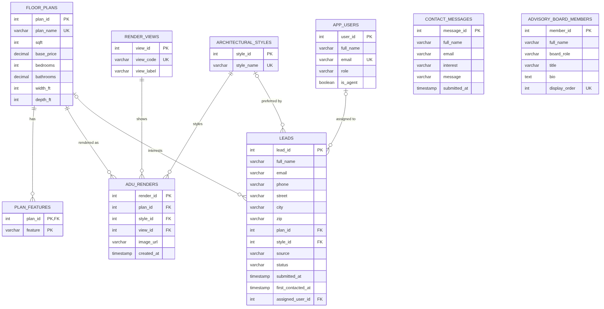

# Axiom3Sixty Database

The data model behind the live website of Axiom3Sixty Group, a sustainable ADU and casita builder in the Phoenix metro. It covers the floor plan catalog, a cache of generated design renders, the lead pipeline from the satellite Property Check tool, contact messages, staff accounts, and the Advisory Board page.


> Shown with Axiom3Sixty Group's permission. This repo publishes the design only. Every person in the seed data is synthetic, and no real leads, staff contacts, or credentials are included.

## The Business Problem

Homeowners find the company through the website, check whether a casita fits their lot with the satellite Property Check tool, preview plans in different finish styles, and submit a lead. The company needed those leads to reach the right person fast and to track each one to close. It also needed the AI generated plan previews cached, so the site never pays twice to generate the same image.

## My Role

I designed, built, and manage the database for the live site at [axiom3sixtygroup.base44.app](https://axiom3sixtygroup.base44.app). The production app runs on Base44, where lead and contact submissions are validated in server functions and routed to the sales team. This repo rebuilds that system as a standard relational schema anyone can run, using the conceptual, logical, and physical design process from my graduate data modeling coursework.

## Data Model



**Conceptual.** Nine entities: floor plans, plan features, architectural styles, render views, renders, leads, contact messages, app users, and advisory board members. A plan, a style, and a view together identify one render. A lead can name a plan and a style and is worked by one agent. [Read more](docs/01-conceptual-model.md)

**Logical.** Surrogate keys throughout, with UNIQUE constraints on the natural names. Plan features move out of a list column into their own table (first normal form). Renders reference plans and styles by key instead of repeating names (third normal form). [Read more](docs/02-logical-model.md)

**Physical.** SQLite and PostgreSQL compatible DDL with CHECK constraints, foreign keys, and indexes on the columns the business filters by. Column lengths match the limits the live server functions enforce. [Read more](docs/03-physical-model.md) | [Data dictionary](docs/data-dictionary.md)

## Design Decisions

1. **DECIMAL for money.** `base_price` is `DECIMAL(10,2)`, never a float.
2. **The render cache is a constraint, not a convention.** `UNIQUE (plan_id, style_id, view_id)` guarantees one image per combination, so the app's fetch or generate call can never create a paid duplicate.
3. **Speed to lead is built in.** Leads store `submitted_at` and `first_contacted_at`, and a CHECK forbids contact before submission.
4. **Controlled vocabularies.** Source, status, and role only accept known values.
5. **Addresses stay as entered.** The lead's street, city, and zip are a record of what the homeowner typed at submission, so they are not normalized into a shared address table.
6. **Security.** Admin and user roles, server side validation and length limits, and a honeypot field that silently drops bot submissions.

## Sample Queries

All queries live in [sql/queries.sql](sql/queries.sql). Results below come from the synthetic seed.

**Which plans draw the most interest, and what is the open pipeline worth?**

```sql
SELECT fp.plan_name, fp.base_price, COUNT(l.lead_id) AS leads,
       SUM(CASE WHEN l.status = 'won' THEN 1 ELSE 0 END) AS won,
       SUM(CASE WHEN l.status IN ('site_visit', 'proposal') THEN fp.base_price ELSE 0 END) AS open_pipeline_value
FROM floor_plans fp
LEFT JOIN leads l ON l.plan_id = fp.plan_id
GROUP BY fp.plan_id
ORDER BY leads DESC;
```

| plan_name | base_price | leads | won | open_pipeline_value |
|---|---|---|---|---|
| Casa Luna | 195,000 | 94 | 8 | 7,215,000 |
| Casa Reina | 180,000 | 90 | 10 | 3,780,000 |
| Casa Lunita | 160,000 | 64 | 7 | 4,160,000 |
| Casa Mia | 145,000 | 45 | 3 | 1,885,000 |
| Casa Reinita | 170,000 | 43 | 6 | 2,380,000 |
| Casa Mio | 150,000 | 38 | 4 | 1,800,000 |

**Where does demand come from?** Gilbert leads with 15.5 percent of leads, then Mesa (13.6), Chandler (13.1), and Scottsdale (12.4).

**Which source converts best?** Among closed leads, chat and contact form leads win more than half the time. Custom design requests win 37.5 percent.

**How fast do agents respond?** Median time to first contact is 12.7 hours, and 76 percent of leads hear back within a day.

**How complete is the render cache?** 78 of 120 possible plan, style, and view images are cached. Casa Reinita sits at 40 percent, the first gap to fill.

## Analysis

[notebooks/lead_analysis.ipynb](notebooks/lead_analysis.ipynb) builds the database, runs every query, and charts leads by city, the funnel, speed to lead, and seasonality.

## Project Structure

```
axiom3sixty-database/
├── README.md
├── docs/
│   ├── erd.png                  entity relationship diagram
│   ├── erd.mmd                  diagram source
│   ├── 01-conceptual-model.md
│   ├── 02-logical-model.md
│   ├── 03-physical-model.md
│   └── data-dictionary.md
├── sql/
│   ├── schema.sql               CREATE TABLE statements
│   ├── seed_synthetic.sql       synthetic rows, no real people
│   └── queries.sql              the business questions
├── src/
│   ├── generate_synthetic.py    reproducible seed generator
│   └── run_queries.py           builds the database and runs every query
├── notebooks/lead_analysis.ipynb
├── data/synthetic_leads.csv
└── tests/                       constraint and query tests
```

## How to Run

```bash
pip install -r requirements.txt
sqlite3 axiom.db < sql/schema.sql
sqlite3 axiom.db < sql/seed_synthetic.sql
python src/run_queries.py
pytest -q
```

## Tech Stack

SQL (SQLite, PostgreSQL compatible), Base44, Python, pandas, Matplotlib, Jupyter, pytest, Mermaid, GitHub Actions

## What I Would Build Next

1. A lead status history table, so the time spent in each pipeline stage can be measured, not just the current stage.
2. A nightly job that pre generates missing renders for the most requested plans.

## Author

Randy O. Powell | [GitHub](https://github.com/TheSavage007) | [LinkedIn](https://www.linkedin.com/in/randy-powell-224a92bb)
