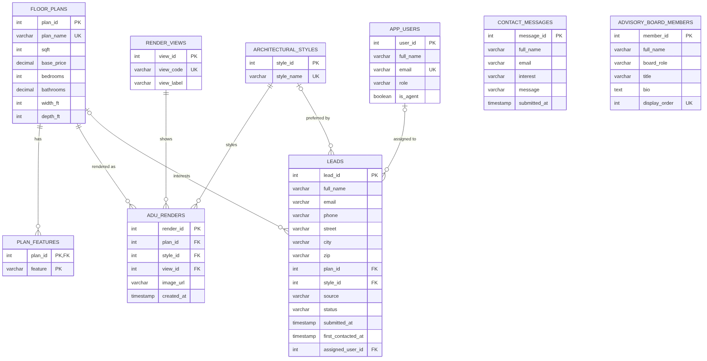

# Logical Model

The logical model turns the conceptual entities into relations with keys and attributes, still independent of any one database engine.

## Relations

- **floor_plans** (<u>plan_id</u>, plan_name, sqft, base_price, bedrooms, bathrooms, width_ft, depth_ft, description)
- **plan_features** (<u>plan_id</u> → floor_plans, <u>feature</u>)
- **architectural_styles** (<u>style_id</u>, style_name)
- **render_views** (<u>view_id</u>, view_code, view_label)
- **adu_renders** (<u>render_id</u>, plan_id → floor_plans, style_id → architectural_styles, view_id → render_views, image_url, created_at), with (plan_id, style_id, view_id) unique
- **app_users** (<u>user_id</u>, full_name, email, role, is_agent, created_at)
- **leads** (<u>lead_id</u>, full_name, email, phone, street, city, zip, plan_id → floor_plans, style_id → architectural_styles, source, status, submitted_at, first_contacted_at, assigned_user_id → app_users)
- **contact_messages** (<u>message_id</u>, full_name, email, interest, message, submitted_at)
- **advisory_board_members** (<u>member_id</u>, full_name, board_role, title, bio, photo_url, display_order)

## Normalization

1. **First normal form.** In the source app, plan features live as a list inside each plan record. Here they move to their own `plan_features` table so every column holds one value.
2. **Second normal form.** `plan_features` uses a composite key of plan and feature, and holds no other attributes, so nothing depends on only part of the key.
3. **Third normal form.** In the source app, renders store the plan name and style name as text. Here they reference `floor_plans` and `architectural_styles` by key, so renaming a style changes one row instead of dozens.
4. **A deliberate exception.** Leads keep the street, city, and zip as typed by the homeowner at the moment of submission. That is a historical record of what they entered, so it is not split into a separate address table.

## Keys

- Surrogate integer keys everywhere, because plan and style names are marketing labels that can change.
- Natural uniqueness is still enforced with UNIQUE constraints on plan_name, style_name, view_code, and user email.
